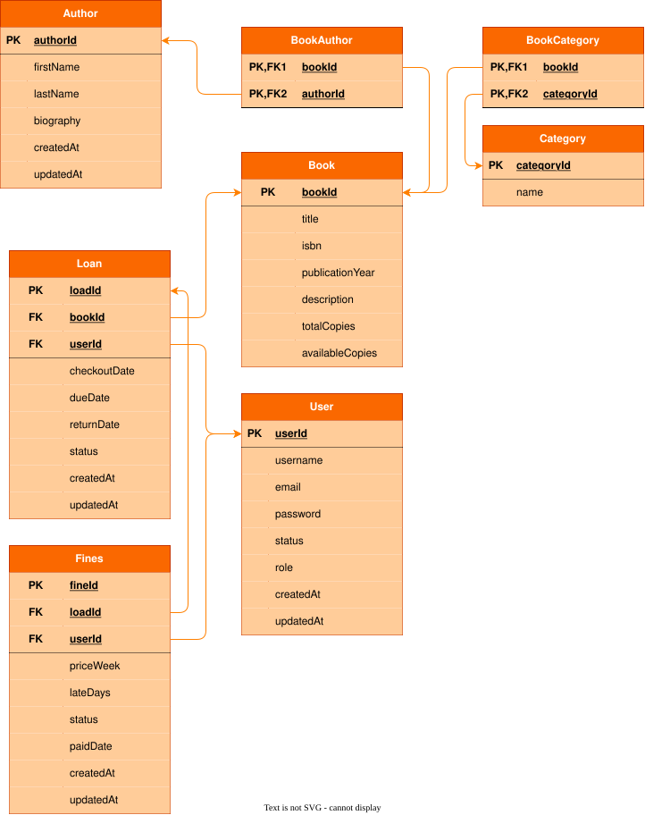

# Project - Library Management Application
---
A robust desktop-based library management application built with Java 25 and JavaFX. Features a modern graphical user interface, secure direct database connectivity with password hashing, and a persistent MySQL relational backend managed via Gradle. Designed to streamline book cataloging, patron tracking, and automated weekly fine calculations.

## ER - Diagram
