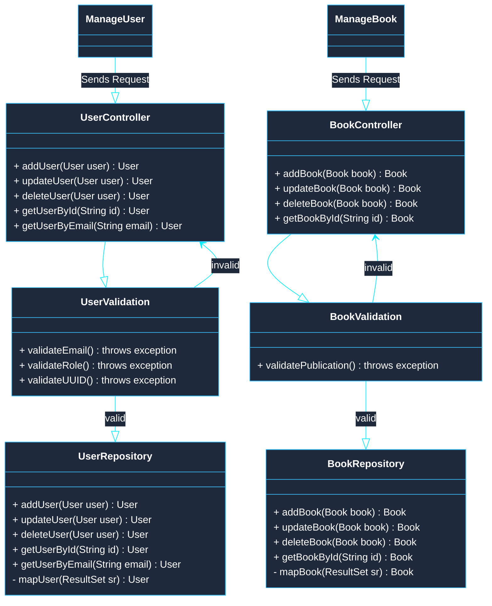

# Project - Library Management Application
---
A robust desktop-based library management application built with Java 25 and JavaFX. Features a modern graphical user interface, secure direct database connectivity with password hashing, and a persistent MySQL relational backend managed via Gradle. Designed to streamline book cataloging, patron tracking, and automated weekly fine calculations.

---
## About me
**Author:** Xeinostorm05
**Degree:** Second-year student - M.S in Computer Science and Science in Engineering (5 years)
**Start Date:** 2026-11-10
**Status:** NOT COMPLETED

---
## Setup
### Environment Variables
```dotenv
# Database configuration
DATABASE_USER=dev_user
DATABASE_PASSWORD=dev_password
DATABASE_HOST=localhost
DATABASE_PORT=3306
DATABASE_NAME=local_db
```
### Database
Install these python dependencies:
```pip
pip install python-dotenv mysql-connector-python
```
After installing the dependencies run the file called `db.py` inside the folder `setup`
```bash
python ./setup/db.py
```
### Java Application
- Install Java 25 JDK
- Install Gradle
- Run the following command:
```bash
./gradlew build
```
- To run the application:
```bash
./gradlew run -q --console=plain
```

---
## ER - Diagram


## Class Diagrams
